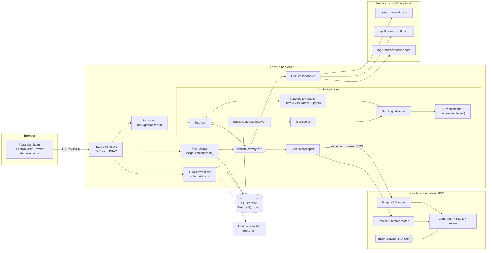
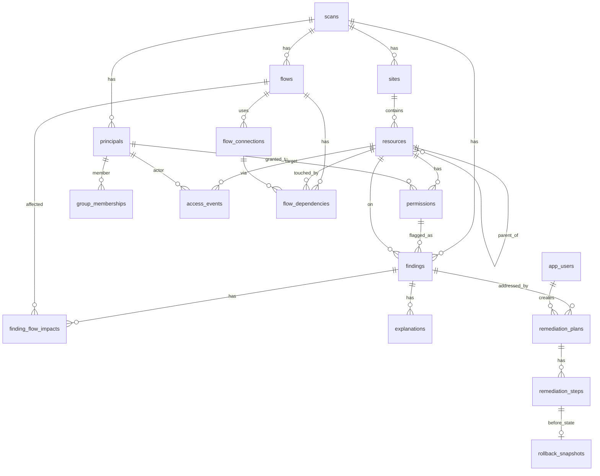
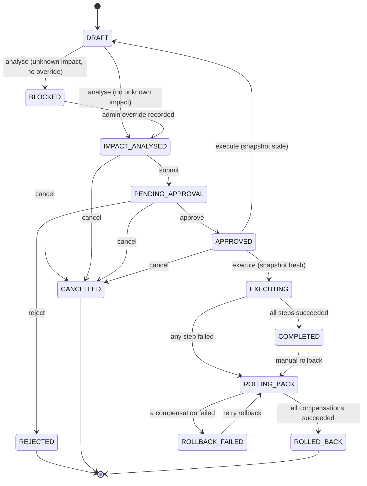

# ARCHITECTURE.md

Context-aware permission governance platform for AI-induced oversharing in Microsoft 365.
APU FYP, supervisor Noris Ismail. Specification version 1.0, 14 Nov 2026. No application code exists yet; this file is the contract the code must satisfy.

## 1. Scope and design decisions

The platform scans SharePoint permissions, maps Power Automate flow dependencies, scores oversharing risk, explains each finding in plain language through an LLM, and executes least-privilege remediation with rollback. It maps to FYP objectives 2 (design), 3 (prototype) and 4 (evaluation in a simulated environment).

Eight decisions shape everything below.

1. The backend never reads tenant data directly. It calls a `TenantGateway` port. Two adapters implement the port, `SimulatorAdapter` and `LiveGraphAdapter`, and both inherit one HTTP client and one set of response parsers. They differ only in base URLs and token acquisition.
2. The simulator is a separate HTTP service that serves the same URL paths and JSON bodies as Microsoft Graph v1.0 and the Power Automate management API. Schema parity is therefore enforced over the wire, and switching to a real tenant is a change of environment variables.
3. The simulator is stateful. Deleting a permission changes what later calls return, and a flow test run fails with a 403-style error when its connection identity has lost access. This is what makes "zero broken workflows" measurable.
4. Every scan is an immutable snapshot keyed by `scan_id`. Findings carry a stable `fingerprint` so a dismissal or an accepted risk survives later scans.
5. Risk is impact multiplied by likelihood. Impact is the sensitivity of the resource. Likelihood is a weighted sum of four factors. All weights and thresholds live in one config file and are returned by the API.
6. Remediation is a saga. Additive steps run first, the destructive step runs last, every step has a recorded compensation, and a failed verification triggers rollback automatically.
7. The LLM receives structured metadata only, never file content. A deterministic template provider is the default, so the system runs with no API key.
8. Background work (scans, remediation runs) uses FastAPI background tasks with a `jobs` table. No message broker.

### 1.1 Known constraints of the real platform

These three points affect the live adapter and belong in the report's limitations section.

The standard SharePoint connector in Power Automate needs a user context. A Microsoft Tech Community post on service principals lists Dataverse as the only standard connector with native service principal sign-in and places the SharePoint standard connector under "requires user context"; custom connectors and HTTP calls to Graph with app permissions do work with a service principal. The brief's step "move the flow's connection to the service principal" is therefore modelled as strategy `service_principal`, which in a real tenant means converting the flow's SharePoint actions to HTTP or Graph calls made by the app. Strategy `scoped_identity_grant` is the fallback that keeps the existing flow identity and gives it a direct, minimal grant.

The Power Automate endpoints under `api.flow.microsoft.com` are widely used but not formally documented by Microsoft. The live adapter must be validated against a real tenant before any claim of production readiness.

The Graph audit log query API (`/security/auditLog/queries`) was moved from v1.0 back to beta in April 2025, and Microsoft message MC1505599 (12 Oct 2026) announces general availability starting October 2026. The audit API version is a config value (`GRAPH_AUDIT_API_VERSION`).

Sources: https://techcommunity.microsoft.com/blog/microsoftmissioncriticalblog/service-principals-in-microsoft-power-platform/4516482, https://practical365.com/auditlog-query-api-deeper-look/, https://mc.merill.net/message/MC1505599

## 2. System architecture

### 2.1 Component diagram



### 2.2 Scan and analysis sequence

```mermaid
sequenceDiagram
  participant A as Admin (browser)
  participant API as FastAPI
  participant J as Job runner
  participant T as TenantGateway
  participant DB as Database

  A->>API: POST /api/v1/scans
  API->>DB: insert scan (queued)
  API-->>A: 202 {id, status: queued}
  J->>T: list users, groups, memberships
  J->>T: list sites, drives, items, permissions
  J->>T: list flows, definitions, connections, runs
  J->>T: query audit records (90 days)
  J->>DB: write snapshot rows
  J->>J: resolve effective access
  J->>J: parse flow JSON, build dependency graph
  J->>J: score findings, detect breakage, build recommendations
  J->>DB: write findings, impacts; scan = completed
  A->>API: GET /api/v1/scans/{id}
  API-->>A: {status: completed, stats}
```

### 2.3 Runtime processes and ports

| Process | Port | Start command | Purpose |
| --- | --- | --- | --- |
| Simulator | 8001 | `make sim` | Graph and Power Automate look-alike |
| Backend API | 8000 | `make api` | REST API, pipeline, remediator |
| Frontend | 5173 | `make web` | React dashboard (Vite dev server) |
| PostgreSQL | 5432 | `docker compose up db` | Production-style database, optional in dev |

### 2.4 Technology choices

| Layer | Choice |
| --- | --- |
| Backend | Python 3.12, FastAPI, Pydantic v2, SQLAlchemy 2.0, Alembic, httpx, NetworkX, PyJWT, passlib (argon2) |
| Frontend | React 18, TypeScript, Vite, React Router, TanStack Query, Tailwind CSS, React Flow (dependency graph), Recharts |
| Database | SQLite 3 with WAL in development, PostgreSQL 16 in production |
| Tests | pytest, pytest-asyncio, respx, Schemathesis (contract), Vitest, Playwright (end to end) |
| Tooling | uv (Python packages), pnpm, Ruff, mypy, ESLint, Docker Compose, GNU Make |

## 3. Monorepo folder structure

```text
fyp-permission-governance/
├── ARCHITECTURE.md
├── ROADMAP.md
├── README.md
├── Makefile                      # seed, sim, api, web, test, verify-m1..m6
├── docker-compose.yml            # db, sim, api, web
├── .env.example
│
├── backend/
│   ├── pyproject.toml
│   ├── alembic.ini
│   ├── alembic/versions/         # one migration per milestone
│   ├── app/
│   │   ├── main.py               # app factory, router mounting, startup recovery
│   │   ├── config.py             # pydantic-settings, reads .env
│   │   ├── db.py                 # engine, session, SQLite pragmas
│   │   ├── security.py           # JWT, password hashing, role guards
│   │   ├── errors.py             # error envelope, exception handlers
│   │   ├── models/               # SQLAlchemy models, one file per table group
│   │   │   ├── scan.py  principal.py  resource.py  permission.py
│   │   │   ├── flow.py  finding.py  remediation.py  audit.py  app_user.py
│   │   ├── schemas/              # Pydantic request and response models
│   │   ├── api/v1/
│   │   │   ├── auth.py  system.py  scans.py  sites.py  resources.py
│   │   │   ├── flows.py  findings.py  remediations.py  metrics.py
│   │   │   ├── audit_log.py  evaluation.py
│   │   ├── gateway/
│   │   │   ├── port.py           # TenantGateway Protocol + DTOs
│   │   │   ├── base_http.py      # shared httpx client, paging, retry, parsers
│   │   │   ├── simulator.py      # SimulatorAdapter
│   │   │   ├── live_graph.py     # LiveGraphAdapter (MSAL client credentials)
│   │   │   └── factory.py        # picks adapter from ADAPTER_MODE
│   │   ├── pipeline/
│   │   │   ├── scanner.py
│   │   │   ├── effective_access.py
│   │   │   ├── flow_parser.py
│   │   │   ├── dependency_graph.py
│   │   │   ├── risk_scorer.py
│   │   │   ├── breakage_detector.py
│   │   │   └── recommender.py
│   │   ├── llm/
│   │   │   ├── provider.py       # LLMProvider Protocol
│   │   │   ├── template_provider.py
│   │   │   ├── anthropic_provider.py
│   │   │   ├── openai_compatible_provider.py
│   │   │   ├── prompts.py
│   │   │   └── validator.py      # checks numbers and names against facts
│   │   ├── remediation/
│   │   │   ├── state_machine.py  # states, transitions, guards
│   │   │   ├── planner.py        # builds ordered steps for a strategy
│   │   │   ├── executor.py       # runs steps, journals, verifies
│   │   │   └── rollback.py       # compensations in reverse order
│   │   ├── jobs/runner.py
│   │   └── scoring_config.yaml   # weights, thresholds, floors
│   └── tests/
│       ├── unit/  integration/  contract/  e2e/
│       └── golden/               # frozen expected scores and impacts
│
├── frontend/
│   ├── package.json  vite.config.ts  tailwind.config.ts  tsconfig.json
│   ├── src/
│   │   ├── main.tsx  App.tsx  routes.tsx
│   │   ├── api/                  # typed client generated from OpenAPI
│   │   ├── auth/                 # login page, token store, route guards
│   │   ├── pages/
│   │   │   ├── LoginPage.tsx  OverviewPage.tsx  ScansPage.tsx
│   │   │   ├── SitesPage.tsx  SiteDetailPage.tsx  ResourcePage.tsx
│   │   │   ├── FindingsPage.tsx  FindingDetailPage.tsx
│   │   │   ├── FlowsPage.tsx  DependencyGraphPage.tsx
│   │   │   ├── DecisionCardsPage.tsx          # business owner view
│   │   │   ├── RemediationsPage.tsx  RemediationDetailPage.tsx
│   │   │   ├── EvaluationPage.tsx  AuditLogPage.tsx
│   │   ├── components/           # RiskBadge, FactorBar, ImpactList, StepTimeline
│   │   └── styles/
│   └── tests/                    # Vitest unit, Playwright e2e
│
└── mock_data/
    ├── README.md
    ├── company_spec.yaml         # hand-written spec: departments, sites, flows, scenarios
    ├── generator/
    │   ├── generate.py           # company_spec.yaml -> tenant/*.json, seed 42
    │   ├── names.py  files.py  audit.py
    ├── tenant/                   # generated, committed, Graph-shaped
    │   ├── manifest.json         # counts and checksums
    │   ├── users.json  groups.json  group_members.json
    │   ├── sites.json  site_groups.json  drives.json
    │   ├── drive_items.json  permissions.json  site_app_permissions.json
    │   ├── sensitivity_labels.json  audit_records.json
    │   ├── flows.json  connections.json  flow_runs.json
    │   └── ground_truth.json     # planted scenarios and expected outcomes
    ├── simulator/
    │   ├── main.py               # FastAPI app on :8001
    │   ├── state.py              # in-memory state, persisted to state/tenant_state.json
    │   ├── access_engine.py      # effective access used by the flow run engine
    │   ├── routes_identity.py    # token endpoint
    │   ├── routes_graph.py       # /v1.0/...
    │   ├── routes_flow.py        # /providers/Microsoft.ProcessSimple/...
    │   ├── routes_spo.py         # /_api/web/sitegroups
    │   └── routes_control.py     # /_sim/reset, /_sim/health, /_sim/flows/{id}/test-run
    ├── state/                    # gitignored
    └── tests/                    # schema parity tests against recorded Graph samples
```

## 4. Pluggable data adapter

### 4.1 Port

`backend/app/gateway/port.py` defines the only interface the pipeline and the remediator may use.

| Method | Returns | Used by |
| --- | --- | --- |
| `list_users()` | users with department, enabled flag, licences | Scanner |
| `list_groups()`, `list_group_members(group_id)` | groups, transitive members | Scanner |
| `list_sites()` | sites | Scanner |
| `list_site_groups(site)`, `list_site_group_members(site, id)` | SharePoint groups and members | Scanner |
| `list_site_app_permissions(site_id)` | application grants on a site | Scanner, Remediator |
| `list_drives(site_id)`, `list_children(drive_id, item_id)` | libraries, folders, files | Scanner |
| `list_item_permissions(drive_id, item_id)` | permission objects | Scanner, Remediator |
| `get_sensitivity_label(drive_id, item_id)` | label assignment | Scanner |
| `query_audit_records(start, end, operations)` | file access events | Scanner |
| `list_flows(environment_id)`, `get_flow(env, flow)` | flow metadata and definition JSON | Scanner |
| `list_flow_runs(env, flow, top)` | run history | Scanner, Remediator |
| `list_connections(env)` | connections with identity and auth type | Scanner |
| `grant_site_app_permission(site_id, app_id, role)` | created permission | Remediator |
| `revoke_site_app_permission(site_id, permission_id)` | none | Rollback |
| `add_item_grant(drive_id, item_id, recipients, role)` | created permissions | Remediator, Rollback |
| `create_link(drive_id, item_id, type, scope)` | created link permission | Rollback |
| `delete_item_permission(drive_id, item_id, permission_id)` | none | Remediator, Rollback |
| `update_flow_connection(env, flow, ref_key, connection_name)` | updated flow | Remediator, Rollback |
| `resubmit_flow_run(env, flow, trigger, run_id)` | new run id | Remediator |
| `get_flow_run(env, flow, run_id)` | run status | Remediator |

### 4.2 Adapters

| Setting | `SimulatorAdapter` | `LiveGraphAdapter` |
| --- | --- | --- |
| `ADAPTER_MODE` | `simulator` | `live` |
| Graph base URL | `http://localhost:8001/v1.0` | `https://graph.microsoft.com/v1.0` |
| Flow base URL | `http://localhost:8001` | `https://api.flow.microsoft.com` |
| SharePoint REST base | `http://localhost:8001/spo` | `https://{tenant}.sharepoint.com` |
| Token | `POST {sim}/{tenant}/oauth2/v2.0/token`, any client secret | MSAL client credentials, certificate preferred |
| Throttling | Simulator returns 429 with `Retry-After` on every 200th call when `SIM_THROTTLE=1` | Real 429 and 503 handling |
| Write operations | Always allowed | Allowed only when `LIVE_WRITES_ENABLED=true` |

Shared behaviour in `base_http.py`: follows `@odata.nextLink` until exhausted, retries 429 and 5xx with exponential backoff honouring `Retry-After` (maximum 5 attempts), sends `client-request-id`, maps Graph error bodies (`{"error": {"code", "message"}}`) to typed exceptions.

Application permissions the live adapter needs: `Sites.Read.All` for scanning (or `Sites.FullControl.All` if the same app grants `Sites.Selected` to the remediation app), `User.Read.All`, `GroupMember.Read.All`, `AuditLogsQuery.Read.All`, plus Power Platform admin rights for flow listing. The remediation service principal itself holds only `Sites.Selected`.

### 4.3 Simulator endpoint surface

Every route returns the Graph JSON shape for that resource, including `@odata.context`, `value` arrays and `@odata.nextLink` paging (default page size 100).

| Method and path | Mirrors |
| --- | --- |
| `POST /{tenantId}/oauth2/v2.0/token` | Entra ID client credentials token |
| `GET /v1.0/users`, `GET /v1.0/users/{id}` | user (with `department`, `accountEnabled`, `userType`, `assignedLicenses`) |
| `GET /v1.0/groups`, `GET /v1.0/groups/{id}/transitiveMembers` | group, directoryObject |
| `GET /v1.0/sites?search=*`, `GET /v1.0/sites/{siteId}` | site |
| `GET /v1.0/sites/{siteId}/permissions` | application permissions on a site |
| `POST /v1.0/sites/{siteId}/permissions` | create application grant (`Sites.Selected`) |
| `DELETE /v1.0/sites/{siteId}/permissions/{permId}` | remove application grant |
| `GET /v1.0/sites/{siteId}/drives` | drive |
| `GET /v1.0/drives/{driveId}/root/children`, `GET /v1.0/drives/{driveId}/items/{itemId}/children` | driveItem |
| `GET /v1.0/drives/{driveId}/items/{itemId}` | driveItem |
| `GET /v1.0/drives/{driveId}/items/{itemId}/permissions` | permission (direct, link, inherited) |
| `POST /v1.0/drives/{driveId}/items/{itemId}/invite` | add direct grants |
| `POST /v1.0/drives/{driveId}/items/{itemId}/createLink` | create sharing link |
| `DELETE /v1.0/drives/{driveId}/items/{itemId}/permissions/{permId}` | remove permission |
| `POST /v1.0/drives/{driveId}/items/{itemId}/extractSensitivityLabels` | label assignment |
| `POST /v1.0/security/auditLog/queries`, `GET .../queries/{id}`, `GET .../queries/{id}/records` | audit log query, async |
| `GET /spo/sites/{sitePath}/_api/web/sitegroups`, `GET .../sitegroups/getbyid({id})/users` | SharePoint REST site groups |
| `GET /providers/Microsoft.ProcessSimple/scopes/admin/environments/{env}/v2/flows` | admin flow list |
| `GET /providers/Microsoft.ProcessSimple/environments/{env}/flows/{flow}` | flow with `definition` and `connectionReferences` |
| `PATCH /providers/Microsoft.ProcessSimple/environments/{env}/flows/{flow}` | update `connectionReferences` |
| `GET .../flows/{flow}/runs`, `GET .../flows/{flow}/runs/{runId}` | run history |
| `POST .../flows/{flow}/triggers/{trigger}/histories/{runId}/resubmit` | resubmit a run |
| `GET /providers/Microsoft.PowerApps/scopes/admin/environments/{env}/connections` | connections |
| `GET /_sim/health`, `POST /_sim/reset`, `POST /_sim/flows/{flow}/test-run` | simulator control, no real equivalent |
| `POST /_sim/faults` | fault injection for tests: `{route, status, count}` or `{flow, force_fail}` |

`GET /_sim/health` returns `{"status": "ok", "state_checksum": "sha256:..."}`; the checksum covers all mutable tenant state and is how tests prove that a call changed nothing or that a rollback restored everything. Flow routes accept and ignore `api-version=2016-11-01`. The `/_sim/*` routes are never called by adapter code that also runs in live mode; only the evaluation harness and the admin reset endpoint use them.

Representative permission objects the simulator returns:

```json
{
  "id": "aTowIy5mfG1lbWJlcnNoaXB8ZXZlcnlvbmU",
  "roles": ["read"],
  "grantedToV2": {
    "siteUser": {
      "id": "7",
      "displayName": "Everyone except external users",
      "loginName": "c:0-.f|rolemanager|spo-grid-all-users/7d3f0c1e-0000-4000-8000-000000000001"
    }
  }
}
```

```json
{
  "id": "b2ZmLWxpbmstMDAx",
  "roles": ["read"],
  "link": { "type": "view", "scope": "organization", "webUrl": "https://lumira.sharepoint.example/:f:/s/contracts/Ek..." },
  "grantedToIdentitiesV2": [
    { "user": { "id": "u-031", "displayName": "Farid Rahman", "email": "farid.rahman@lumira.example" } }
  ],
  "hasPassword": false
}
```

```json
{
  "id": "Z3JvdXAtZmluYW5jZQ",
  "roles": ["write"],
  "grantedToV2": { "group": { "id": "g-finance", "displayName": "Finance Team" } },
  "inheritedFrom": { "driveId": "b!fin001", "id": "01FINROOT", "path": "/drives/b!fin001/root:" }
}
```

Representative flow object (trimmed):

```json
{
  "name": "f02-payroll-export",
  "id": "/providers/Microsoft.ProcessSimple/environments/Default-7d3f0c1e/flows/f02-payroll-export",
  "type": "Microsoft.ProcessSimple/environments/flows",
  "properties": {
    "displayName": "Payroll export to bank folder",
    "state": "Started",
    "createdTime": "2025-03-04T02:11:00Z",
    "lastModifiedTime": "2026-08-19T07:40:00Z",
    "creator": { "tenantId": "7d3f0c1e-0000-4000-8000-000000000001", "objectId": "u-048", "userId": "u-048", "userType": "ActiveDirectory" },
    "connectionReferences": {
      "shared_sharepointonline": {
        "connectionName": "shared-sharepointonl-svc-automation",
        "id": "/providers/Microsoft.PowerApps/apis/shared_sharepointonline",
        "displayName": "SharePoint",
        "tier": "Standard"
      }
    },
    "definition": {
      "$schema": "https://schema.management.azure.com/providers/Microsoft.Logic/schemas/2016-06-01/workflowdefinition.json#",
      "triggers": {
        "Recurrence": { "type": "Recurrence", "recurrence": { "frequency": "Month", "interval": 1 } }
      },
      "actions": {
        "List_payroll_files": {
          "type": "OpenApiConnection",
          "inputs": {
            "host": {
              "apiId": "/providers/Microsoft.PowerApps/apis/shared_sharepointonline",
              "connectionName": "shared_sharepointonline",
              "operationId": "ListFolder"
            },
            "parameters": {
              "dataset": "https://lumira.sharepoint.example/sites/payroll",
              "id": "%252fShared%2bDocuments%252fMonthly%2bRuns"
            }
          },
          "runAfter": {}
        }
      }
    }
  }
}
```

### 4.4 Simulated company

Lumira Trading is fictional. Tenant id `7d3f0c1e-0000-4000-8000-000000000001`, domain `lumira.example`, SharePoint host `lumira.sharepoint.example`, environment `Default-7d3f0c1e`. The generator is deterministic (seed 42) and writes `manifest.json` with the exact counts below.

Users, 50 in total: 46 employees (Executive 3, Finance 7, HR 5, Sales 9, Operations 8, IT 6, Legal 4, Marketing 4), 2 service accounts (`svc-automation`, `svc-reports`), 2 external guests. 20 employees hold a Copilot licence. N, the count of enabled member users, is 48.

Groups, 12 in total: 8 department groups, All Staff, Finance Managers, HR Business Partners, Project Phoenix Core.

Sites, 15 in total:

| # | Site | Owner department | Default label |
| --- | --- | --- | --- |
| 1 | finance | Finance | Confidential |
| 2 | payroll | HR | Highly Confidential |
| 3 | hr | HR | Confidential |
| 4 | recruitment | HR | Confidential |
| 5 | sales | Sales | General |
| 6 | contracts | Legal | Confidential |
| 7 | legal | Legal | Highly Confidential |
| 8 | board | Executive | Confidential |
| 9 | it-helpdesk | IT | General |
| 10 | it-infra | IT | Confidential |
| 11 | operations | Operations | General |
| 12 | procurement | Operations | Confidential |
| 13 | marketing | Marketing | Public |
| 14 | intranet | IT | General |
| 15 | project-phoenix | Executive | Highly Confidential |

Flows, 10 in total:

| Flow | Name | Connection identity | Reads or writes | Required role | Access path of the identity |
| --- | --- | --- | --- | --- | --- |
| F01 | Invoice approval routing | Finance analyst | finance/Invoices | write | Finance Team group |
| F02 | Payroll export to bank folder | svc-automation | payroll/Monthly Runs | read | Everyone except external users only |
| F03 | New hire onboarding | HR officer | recruitment/Offers, hr/Employee Files | write | HR Team group |
| F04 | Contract expiry reminder | Employee who moved from Sales to Marketing | contracts/Active | read | Organisation link only |
| F05 | Sales weekly report | svc-reports | sales/Pipeline (read), board/Reports (write) | write | Everyone except external users (write) on board/Reports |
| F06 | Helpdesk attachment archive | IT technician | it-helpdesk/Tickets | write | IT Team group |
| F07 | Purchase order approval | Operations clerk in a different unit | procurement/Purchase Orders | read | All Staff group only |
| F08 | Marketing asset publish | Marketing executive | marketing/Brand Assets, intranet/News | write | Marketing Team group |
| F09 | Board pack distribution | Executive assistant | project-phoenix, folder from a dynamic expression | read | Everyone except external users only |
| F10 | Leave request sync | HR officer from another entity | hr/Leave | read | Everyone except external users only |

Planted oversharing scenarios, 12 in total, recorded in `ground_truth.json`:

| ID | Resource | Broad grant | Label | Dependent flow | Expected impact | Minimum band |
| --- | --- | --- | --- | --- | --- | --- |
| P01 | payroll/Monthly Runs | Everyone except external users, read | Highly Confidential | F02 | BREAKS | Critical |
| P02 | contracts/Active | Organisation link, view, no expiry | Confidential | F04 | BREAKS | Medium |
| P03 | board/Reports | Everyone except external users, write | Confidential | F05 | BREAKS | High |
| P04 | procurement/Purchase Orders | All Staff group, read | Confidential | F07 | BREAKS | Medium |
| P05 | project-phoenix/Board Packs | Everyone except external users, read | Highly Confidential | F09 | UNKNOWN (truth: breaks) | Critical |
| P06 | hr/Leave | Everyone except external users, read | Confidential | F10 | BREAKS | Medium |
| P07 | finance/Invoices | Everyone except external users, read | Confidential | F01 | SAFE | Medium |
| P08 | hr/Employee Files/Salary Review 2026.xlsx | Anonymous link, view | Highly Confidential | none | none | Critical |
| P09 | legal/Litigation | External guest, write | Highly Confidential | none | none | Critical |
| P10 | it-infra/Credentials Vault Export.xlsx | Organisation link, edit | Highly Confidential | none | none | Critical |
| P11 | sales/Customer List.xlsx | Everyone except external users, read | General, tagged `pii` | none | none | Medium |
| P12 | recruitment/Candidate CVs | Organisation link, view | Confidential, tagged `pii` | none | none | Medium |

Two benign broad grants exist as true negatives and must score Low: Everyone except external users with read on intranet (General) and an organisation link on marketing/Brand Assets (Public). The generator creates no other broad grants, so a full scan yields exactly 14 findings: 12 at Medium or above and 2 Low.

Across all 14 findings the breakage detector must produce 9 impact rows: 5 BREAKS (P01, P02, P03, P04, P06), 1 UNKNOWN (P05) and 3 SAFE (F01 on P07, and F08 on each of the two benign grants).

The generator also guarantees that, for every Everyone-type planted grant, at most 25% of the exposed users have an access event in the last 90 days. For P01 it fixes audience at 48, exposed at 44 and active at 4. The P10 link has no use inside the window. A naive removal of all 12 planted grants breaks 6 flows (F02, F04, F05, F07, F09, F10). This is the baseline for objective 4.

## 5. Database schema

All primary keys are UUID v4 stored as `TEXT` (SQLite) or `UUID` (PostgreSQL). All timestamps are UTC, ISO 8601. JSON columns are `JSON` in SQLite and `JSONB` in PostgreSQL. Every snapshot table has `scan_id` with `ON DELETE CASCADE`.

### 5.1 Entity relationships



### 5.2 Tables

`app_users`

| Column | Type | Constraints |
| --- | --- | --- |
| id | uuid | PK |
| email | text | unique, not null |
| display_name | text | not null |
| password_hash | text | not null |
| role | text | `admin` or `owner`, not null |
| department | text | null for admins; owners see findings for sites owned by this department |
| is_active | boolean | default true |
| created_at | timestamp | not null |

`scans`

| Column | Type | Constraints |
| --- | --- | --- |
| id | uuid | PK |
| adapter_mode | text | `simulator` or `live` |
| status | text | `queued`, `running`, `completed`, `failed` |
| phase | text | `identity`, `inventory`, `flows`, `audit`, `analysis`, null |
| progress_pct | integer | 0 to 100 |
| scope | json | `{ "site_ids": [...] or null, "audit_lookback_days": 90 }` |
| stats | json | counts written at completion |
| error | text | null unless failed |
| started_by | uuid | FK app_users.id |
| started_at, finished_at | timestamp | |

`principals`

| Column | Type | Constraints |
| --- | --- | --- |
| id | uuid | PK |
| scan_id | uuid | FK scans.id, indexed |
| graph_id | text | not null; unique with scan_id |
| kind | text | `user`, `group`, `site_group`, `application`, `everyone`, `everyone_except_external` |
| display_name | text | |
| upn | text | users only |
| department, job_title | text | users only |
| account_enabled | boolean | users only |
| is_guest | boolean | default false |
| has_copilot_license | boolean | default false |

`group_memberships`

| Column | Type | Constraints |
| --- | --- | --- |
| scan_id | uuid | FK scans.id |
| group_principal_id | uuid | FK principals.id |
| member_principal_id | uuid | FK principals.id; transitive closure, users only |
| | | PK (group_principal_id, member_principal_id) |

`sites`

| Column | Type | Constraints |
| --- | --- | --- |
| id | uuid | PK |
| scan_id | uuid | FK scans.id |
| graph_id | text | `hostname,siteCollectionId,webId` |
| name, web_url | text | |
| owner_department | text | |
| owner_group_principal_id | uuid | FK principals.id, null allowed |
| restricted_content_discovery | boolean | default false |
| risk_score | integer | max finding score on the site, null before analysis |
| risk_band | text | |

`resources`

| Column | Type | Constraints |
| --- | --- | --- |
| id | uuid | PK |
| scan_id | uuid | FK scans.id |
| site_id | uuid | FK sites.id, indexed |
| parent_id | uuid | FK resources.id, null for library root |
| kind | text | `library`, `folder`, `file` |
| drive_id, graph_item_id | text | unique together with scan_id |
| name, path, web_url | text | `path` is the server-relative path, indexed |
| depth | integer | 0 at library root |
| sensitivity_label | text | `None`, `Public`, `General`, `Confidential`, `Highly Confidential` |
| classification_tags | json | subset of `pii`, `financial`, `credentials`, `legal_privilege` |
| has_unique_permissions | boolean | true when at least one permission lacks `inheritedFrom` |
| size_bytes | integer | |
| last_modified_at | timestamp | |

`permissions`

| Column | Type | Constraints |
| --- | --- | --- |
| id | uuid | PK |
| scan_id | uuid | FK scans.id |
| resource_id | uuid | FK resources.id, indexed |
| graph_permission_id | text | not null |
| principal_id | uuid | FK principals.id, null for anonymous and organisation links |
| role | text | `read`, `write`, `owner` (normalised) |
| grant_kind | text | `direct`, `group`, `site_group`, `everyone`, `link` |
| link_scope | text | `anonymous`, `organization`, `users`, null |
| link_type | text | `view`, `edit`, null |
| link_expires_at | timestamp | null means no expiry |
| redeemed_principal_ids | json | users listed in `grantedToIdentitiesV2` |
| inherited_from_resource_id | uuid | FK resources.id, null when defined on this resource |
| is_broad | boolean | set by the scorer, see section 7.1 |
| raw | json | the Graph permission object, used for rollback |

`access_events`

| Column | Type | Constraints |
| --- | --- | --- |
| id | uuid | PK |
| scan_id | uuid | FK scans.id |
| resource_id | uuid | FK resources.id, indexed |
| principal_id | uuid | FK principals.id |
| operation | text | `FileAccessed`, `FileDownloaded`, `FileModified`, `FilePreviewed` |
| via_link | boolean | |
| occurred_at | timestamp | indexed |

`flows`

| Column | Type | Constraints |
| --- | --- | --- |
| id | uuid | PK |
| scan_id | uuid | FK scans.id |
| graph_flow_name | text | flow GUID or name, unique with scan_id |
| environment_id | text | |
| display_name | text | |
| state | text | `Started`, `Stopped`, `Suspended` |
| owner_principal_id | uuid | FK principals.id |
| trigger_kind | text | `Recurrence`, `OpenApiConnection`, `Request` |
| trigger_name | text | |
| last_run_id | text | |
| last_run_status | text | `Succeeded`, `Failed`, `Cancelled`, null |
| last_run_at | timestamp | |
| definition | json | full flow definition |

`flow_connections`

| Column | Type | Constraints |
| --- | --- | --- |
| id | uuid | PK |
| flow_id | uuid | FK flows.id |
| ref_key | text | key in `connectionReferences`, for example `shared_sharepointonline` |
| api_id | text | connector API id |
| connection_name | text | |
| identity_principal_id | uuid | FK principals.id |
| auth_type | text | `user` or `service_principal` |

`flow_dependencies`

| Column | Type | Constraints |
| --- | --- | --- |
| id | uuid | PK |
| flow_id | uuid | FK flows.id, indexed |
| connection_id | uuid | FK flow_connections.id |
| site_id | uuid | FK sites.id |
| resource_id | uuid | FK resources.id, null when unresolved |
| action_name | text | action or trigger key in the definition |
| operation_id | text | connector operation |
| required_role | text | `read` or `write` |
| resolution | text | `exact`, `site_level`, `unresolved` |
| raw_reference | text | the undecoded parameter value |

`findings`

| Column | Type | Constraints |
| --- | --- | --- |
| id | uuid | PK |
| scan_id | uuid | FK scans.id, indexed |
| fingerprint | text | sha256 of site graph id, item graph id, finding_type, principal key; indexed |
| resource_id | uuid | FK resources.id |
| permission_id | uuid | FK permissions.id |
| finding_type | text | `EVERYONE_GRANT`, `ORG_LINK`, `ANONYMOUS_LINK`, `LARGE_GROUP`, `EXTERNAL_GUEST` |
| score | integer | 0 to 100 |
| band | text | `Low`, `Medium`, `High`, `Critical` |
| factors | json | `{s, e, a, x, h, likelihood, floor_applied}` |
| audience_count | integer | users who reach the resource through this grant |
| exposed_count | integer | users who would lose access on removal |
| active_count | integer | exposed users with an access event in the lookback window |
| recommendation | json | see section 7.4 |
| status | text | `open`, `planned`, `remediated`, `dismissed`, `accepted_risk` |
| status_reason | text | |
| status_changed_by | uuid | FK app_users.id |

`finding_flow_impacts`

| Column | Type | Constraints |
| --- | --- | --- |
| id | uuid | PK |
| finding_id | uuid | FK findings.id, indexed |
| flow_id | uuid | FK flows.id |
| dependency_id | uuid | FK flow_dependencies.id |
| impact | text | `BREAKS`, `SAFE`, `UNKNOWN` |
| required_role | text | |
| remaining_role | text | `none`, `read`, `write`, `owner` |
| reason | text | machine-readable code, see section 7.3 |
| flags | json | subset of `owner_left_department`, `last_run_failed`, `flow_stopped` |

`explanations`

| Column | Type | Constraints |
| --- | --- | --- |
| id | uuid | PK |
| finding_fingerprint | text | indexed |
| finding_id | uuid | FK findings.id |
| audience | text | `owner` or `admin` |
| provider, model | text | |
| facts_hash | text | sha256 of the facts JSON; unique with audience and provider |
| content | json | structured explanation, see section 8.6 |
| validation | json | `{passed, violations}` |
| created_at | timestamp | |

`remediation_plans`

| Column | Type | Constraints |
| --- | --- | --- |
| id | uuid | PK |
| finding_id | uuid | FK findings.id |
| finding_fingerprint | text | indexed |
| resource_graph_key | text | `driveId:itemId`; partial unique index where state is active |
| strategy | text | `service_principal` or `scoped_identity_grant` |
| state | text | see section 9 |
| version | integer | optimistic lock, incremented on every transition |
| keep_principal_graph_ids | json | users who keep access through a replacement grant |
| replacement_group_graph_id | text | owning group, null allowed |
| unknown_impact_override | json | `{by, reason, at}` or null |
| exposed_before | integer | |
| exposed_after_expected | integer | |
| exposed_after_actual | integer | null until verified |
| created_by, approved_by, executed_by | uuid | FK app_users.id |
| decision_comment | text | |
| failure | json | `{step_seq, code, message}` or null |
| created_at, updated_at, completed_at | timestamp | |

`remediation_steps`

| Column | Type | Constraints |
| --- | --- | --- |
| id | uuid | PK |
| plan_id | uuid | FK remediation_plans.id, indexed |
| seq | integer | unique with plan_id |
| action | text | see section 9.3 |
| target | json | ids the step acts on |
| status | text | `pending`, `running`, `succeeded`, `failed`, `skipped`, `compensated`, `compensation_failed` |
| idempotency_key | text | `plan_id:seq` |
| request, response | json | what was sent and returned |
| error | json | |
| started_at, finished_at | timestamp | |

`rollback_snapshots`

| Column | Type | Constraints |
| --- | --- | --- |
| id | uuid | PK |
| plan_id | uuid | FK remediation_plans.id |
| step_id | uuid | FK remediation_steps.id, unique |
| kind | text | `permission`, `connection_reference`, `site_app_permission` |
| payload | json | the before-state, enough to recreate it |

`jobs`

| Column | Type | Constraints |
| --- | --- | --- |
| id | uuid | PK |
| kind | text | `scan`, `remediation_execute`, `remediation_rollback` |
| ref_id | uuid | scan or plan id |
| status | text | `queued`, `running`, `succeeded`, `failed` |
| heartbeat_at, created_at, finished_at | timestamp | |

`audit_log`

| Column | Type | Constraints |
| --- | --- | --- |
| id | uuid | PK |
| actor_user_id | uuid | FK app_users.id, null for system |
| action | text | for example `scan.started`, `finding.dismissed`, `plan.approved`, `step.succeeded` |
| entity_type, entity_id | text | |
| detail | json | |
| occurred_at | timestamp | indexed |

The audit log is append-only. No update or delete route exists for it.

## 6. API contract

Base path `/api/v1`. JSON only. All routes except `/auth/login` and `/health` need `Authorization: Bearer <jwt>`. OpenAPI is served at `/docs` and `/openapi.json`, and the frontend client is generated from it.

### 6.1 Conventions

Roles: `admin` (IT administrator, full access) and `owner` (business owner, sees findings and plans for sites whose `owner_department` equals their department, may approve or reject, may not execute).

The query parameter `scan_id` defaults to `latest`, the most recent completed scan.

List responses use one envelope:

```json
{ "items": [], "page": 1, "page_size": 25, "total": 0 }
```

Errors use one envelope, with HTTP status 400, 401, 403, 404, 409, 422, 502 or 500:

```json
{
  "error": {
    "code": "PLAN_STATE_CONFLICT",
    "message": "Plan is in state EXECUTING and cannot be approved.",
    "details": { "state": "EXECUTING" },
    "request_id": "c0a8012e-5f1d-4d6b-9d5e-2f6b1d3c9a10"
  }
}
```

Error codes: `VALIDATION_ERROR`, `UNAUTHENTICATED`, `FORBIDDEN`, `NOT_FOUND`, `SCAN_ALREADY_RUNNING`, `NO_COMPLETED_SCAN`, `PLAN_STATE_CONFLICT`, `PLAN_VERSION_CONFLICT`, `ACTIVE_PLAN_EXISTS`, `UNKNOWN_IMPACT_BLOCKED`, `SNAPSHOT_STALE`, `SEPARATE_APPROVER_REQUIRED`, `TENANT_GATEWAY_ERROR`, `LLM_PROVIDER_ERROR`, `LIVE_WRITES_DISABLED`, `SIMULATOR_ONLY`, `INTERNAL_ERROR`.

### 6.2 Endpoint index

| # | Method | Path | Role | Success |
| --- | --- | --- | --- | --- |
| 1 | POST | /auth/login | public | 200 |
| 2 | GET | /auth/me | any | 200 |
| 3 | GET | /health | public | 200 |
| 4 | GET | /config/scoring | any | 200 |
| 5 | POST | /scans | admin | 202 |
| 6 | GET | /scans | admin | 200 |
| 7 | GET | /scans/{scan_id} | admin | 200 |
| 8 | GET | /sites | any | 200 |
| 9 | GET | /sites/{site_id} | any | 200 |
| 10 | GET | /sites/{site_id}/resources | any | 200 |
| 11 | GET | /resources/{resource_id} | any | 200 |
| 12 | GET | /resources/{resource_id}/effective-access | any | 200 |
| 13 | GET | /flows | any | 200 |
| 14 | GET | /flows/{flow_id} | any | 200 |
| 15 | GET | /dependency-graph | any | 200 |
| 16 | GET | /findings | any | 200 |
| 17 | GET | /findings/{finding_id} | any | 200 |
| 18 | PATCH | /findings/{finding_id} | any | 200 |
| 19 | POST | /findings/{finding_id}/simulate | any | 200 |
| 20 | GET | /findings/{finding_id}/explanation | any | 200 |
| 21 | POST | /findings/{finding_id}/explanation | any | 200 |
| 22 | POST | /remediations | admin | 201 |
| 23 | GET | /remediations | any | 200 |
| 24 | GET | /remediations/{plan_id} | any | 200 |
| 25 | POST | /remediations/{plan_id}/submit | admin | 200 |
| 26 | POST | /remediations/{plan_id}/approve | any | 200 |
| 27 | POST | /remediations/{plan_id}/reject | any | 200 |
| 28 | POST | /remediations/{plan_id}/cancel | admin | 200 |
| 29 | POST | /remediations/{plan_id}/execute | admin | 202 |
| 30 | POST | /remediations/{plan_id}/rollback | admin | 202 |
| 31 | GET | /metrics/summary | any | 200 |
| 32 | GET | /audit-log | admin | 200 |
| 33 | GET | /evaluation/ground-truth | admin | 200 |
| 34 | POST | /evaluation/naive-baseline | admin | 200 |
| 35 | POST | /admin/simulator/reset | admin | 200 |

### 6.3 Auth and system

1. `POST /auth/login`

```json
{ "email": "admin@lumira.example", "password": "ChangeMe!123" }
```

```json
{
  "access_token": "eyJhbGciOiJIUzI1NiIs...",
  "token_type": "bearer",
  "expires_in": 3600,
  "user": { "id": "5b1e...", "email": "admin@lumira.example", "display_name": "IT Admin", "role": "admin", "department": null }
}
```

2. `GET /auth/me` returns the `user` object above.

3. `GET /health`

```json
{
  "status": "ok",
  "version": "0.1.0",
  "adapter_mode": "simulator",
  "database": "ok",
  "tenant_gateway": "ok",
  "llm_provider": "template",
  "latest_scan_id": "9f0c..."
}
```

`status` is `degraded` when the gateway or database check fails; the route still returns 200.

4. `GET /config/scoring`

```json
{
  "version": "1.0",
  "impact": { "None": 0.10, "Public": 0.10, "General": 0.30, "Confidential": 0.70, "Highly Confidential": 1.00, "tag_floor": 0.70 },
  "likelihood_weights": { "e": 0.45, "a": 0.20, "x": 0.20, "h": 0.15 },
  "bands": { "Low": [0, 24], "Medium": [25, 49], "High": [50, 74], "Critical": [75, 100] },
  "floors": { "anonymous_link_on_confidential": 90, "guest_write_on_highly_confidential": 80 },
  "broad_group_ratio": 0.50,
  "audit_lookback_days": 90
}
```

### 6.4 Scans

5. `POST /scans`

```json
{ "site_ids": null, "audit_lookback_days": 90 }
```

Response 202:

```json
{ "id": "9f0c...", "status": "queued", "created_at": "2026-11-14T10:00:00Z" }
```

Returns 409 `SCAN_ALREADY_RUNNING` when a scan is queued or running.

6. `GET /scans?page=1&page_size=25` returns the list envelope with scan objects.

7. `GET /scans/{scan_id}`

```json
{
  "id": "9f0c...",
  "adapter_mode": "simulator",
  "status": "completed",
  "phase": null,
  "progress_pct": 100,
  "scope": { "site_ids": null, "audit_lookback_days": 90 },
  "stats": {
    "users": 50, "groups": 12, "sites": 15, "resources": 412, "permissions": 1630,
    "flows": 10, "flow_dependencies": 14, "access_events": 5210,
    "findings": 14, "findings_by_band": { "Low": 2, "Medium": 2, "High": 5, "Critical": 5 },
    "impacts": { "BREAKS": 5, "SAFE": 3, "UNKNOWN": 1 }
  },
  "error": null,
  "started_at": "2026-11-14T10:00:01Z",
  "finished_at": "2026-11-14T10:00:19Z"
}
```

The `resources`, `permissions`, `flow_dependencies`, `access_events` and per-band numbers above are illustrative. The real values are fixed by `manifest.json` and the golden files once the generator and scorer exist.

### 6.5 Inventory

8. `GET /sites?scan_id=latest&sort=-risk_score`

```json
{
  "items": [
    {
      "id": "a1...", "graph_id": "lumira.sharepoint.example,2c9a...,7e1b...", "name": "payroll",
      "web_url": "https://lumira.sharepoint.example/sites/payroll", "owner_department": "HR",
      "risk_score": 79, "risk_band": "Critical",
      "resource_count": 31, "open_finding_count": 1, "dependent_flow_count": 1
    }
  ],
  "page": 1, "page_size": 25, "total": 15
}
```

9. `GET /sites/{site_id}` returns the site object plus `owner_group` (`{id, display_name, member_count}`) and `findings_by_band`.

10. `GET /sites/{site_id}/resources?parent_id=<uuid or omitted for roots>&page=1`

```json
{
  "items": [
    {
      "id": "r1...", "kind": "folder", "name": "Monthly Runs", "path": "/sites/payroll/Shared Documents/Monthly Runs",
      "sensitivity_label": "Highly Confidential", "classification_tags": ["financial", "pii"],
      "has_unique_permissions": true, "child_count": 12, "max_finding_score": 79
    }
  ],
  "page": 1, "page_size": 50, "total": 4
}
```

11. `GET /resources/{resource_id}`

```json
{
  "id": "r1...", "site_id": "a1...", "parent_id": "r0...", "kind": "folder", "name": "Monthly Runs",
  "path": "/sites/payroll/Shared Documents/Monthly Runs", "web_url": "https://lumira.sharepoint.example/sites/payroll/Shared%20Documents/Monthly%20Runs",
  "sensitivity_label": "Highly Confidential", "classification_tags": ["financial", "pii"],
  "has_unique_permissions": true,
  "permissions": [
    {
      "id": "p1...", "graph_permission_id": "aTowIy5mfG1lbWJlcnNoaXB8ZXZlcnlvbmU", "role": "read", "grant_kind": "everyone",
      "principal": { "id": "pr9...", "kind": "everyone_except_external", "display_name": "Everyone except external users" },
      "link": null, "inherited_from": null, "is_broad": true
    }
  ],
  "finding_ids": ["f1..."],
  "dependent_flow_ids": ["fl2..."]
}
```

12. `GET /resources/{resource_id}/effective-access?page=1&page_size=50`

```json
{
  "items": [
    {
      "principal": { "id": "pr3...", "display_name": "Aina Zulkifli", "upn": "aina.zulkifli@lumira.example", "department": "Sales", "has_copilot_license": true },
      "max_role": "read",
      "paths": [ { "permission_id": "p1...", "grant_kind": "everyone", "via": "Everyone except external users", "role": "read" } ],
      "last_access_at": null
    }
  ],
  "page": 1, "page_size": 50, "total": 48
}
```

### 6.6 Flows and dependency graph

13. `GET /flows?scan_id=latest`

```json
{
  "items": [
    {
      "id": "fl2...", "graph_flow_name": "f02-payroll-export", "display_name": "Payroll export to bank folder",
      "state": "Started", "owner": { "id": "pr48...", "display_name": "svc-automation" },
      "last_run_status": "Succeeded", "last_run_at": "2026-11-01T01:00:12Z",
      "dependency_count": 1, "at_risk_finding_count": 1
    }
  ],
  "page": 1, "page_size": 25, "total": 10
}
```

14. `GET /flows/{flow_id}`

```json
{
  "id": "fl2...", "display_name": "Payroll export to bank folder", "state": "Started",
  "environment_id": "Default-7d3f0c1e", "trigger_kind": "Recurrence",
  "owner": { "id": "pr48...", "display_name": "svc-automation", "department": null },
  "connections": [
    { "id": "c1...", "ref_key": "shared_sharepointonline", "connection_name": "shared-sharepointonl-svc-automation",
      "identity": { "id": "pr48...", "display_name": "svc-automation" }, "auth_type": "user" }
  ],
  "dependencies": [
    { "id": "d1...", "action_name": "List_payroll_files", "operation_id": "ListFolder", "required_role": "read",
      "resolution": "exact", "site": { "id": "a1...", "name": "payroll" },
      "resource": { "id": "r1...", "path": "/sites/payroll/Shared Documents/Monthly Runs" } }
  ],
  "impacted_by_findings": [ { "finding_id": "f1...", "impact": "BREAKS" } ]
}
```

15. `GET /dependency-graph?scan_id=latest&site_id=<optional>`

```json
{
  "nodes": [
    { "id": "flow:fl2...", "type": "flow", "label": "Payroll export to bank folder" },
    { "id": "identity:pr48...", "type": "identity", "label": "svc-automation" },
    { "id": "resource:r1...", "type": "resource", "label": "payroll/Monthly Runs", "band": "Critical" },
    { "id": "grant:p1...", "type": "grant", "label": "Everyone except external users (read)", "is_broad": true }
  ],
  "edges": [
    { "source": "flow:fl2...", "target": "identity:pr48...", "type": "runs_as" },
    { "source": "flow:fl2...", "target": "resource:r1...", "type": "reads", "required_role": "read" },
    { "source": "identity:pr48...", "target": "grant:p1...", "type": "access_via" },
    { "source": "grant:p1...", "target": "resource:r1...", "type": "grants" }
  ]
}
```

### 6.7 Findings

16. `GET /findings?scan_id=latest&band=Critical,High&site_id=&finding_type=&status=open&has_flow_impact=true&impact=BREAKS&sort=-score&page=1&page_size=25`

```json
{
  "items": [
    {
      "id": "f1...", "fingerprint": "6c1f...", "finding_type": "EVERYONE_GRANT", "score": 79, "band": "Critical", "status": "open",
      "site": { "id": "a1...", "name": "payroll" },
      "resource": { "id": "r1...", "name": "Monthly Runs", "path": "/sites/payroll/Shared Documents/Monthly Runs", "sensitivity_label": "Highly Confidential" },
      "grant_summary": "Everyone except external users can read",
      "exposed_count": 44, "active_count": 4,
      "impact_summary": { "BREAKS": 1, "SAFE": 0, "UNKNOWN": 0 }
    }
  ],
  "page": 1, "page_size": 25, "total": 14
}
```

17. `GET /findings/{finding_id}`

```json
{
  "id": "f1...", "fingerprint": "6c1f...", "scan_id": "9f0c...", "finding_type": "EVERYONE_GRANT",
  "score": 79, "band": "Critical", "status": "open", "status_reason": null,
  "factors": { "s": 1.0, "e": 0.9, "a": 1.0, "x": 0.91, "h": 0.0, "likelihood": 0.787, "floor_applied": null },
  "site": { "id": "a1...", "name": "payroll", "owner_department": "HR" },
  "resource": { "id": "r1...", "name": "Monthly Runs", "path": "/sites/payroll/Shared Documents/Monthly Runs", "sensitivity_label": "Highly Confidential", "classification_tags": ["financial", "pii"] },
  "permission": { "id": "p1...", "graph_permission_id": "aTowIy5mfG1lbWJlcnNoaXB8ZXZlcnlvbmU", "role": "read", "grant_kind": "everyone", "principal_display_name": "Everyone except external users", "link": null },
  "audience_count": 48, "exposed_count": 44, "active_count": 4,
  "exposed_by_department": [ { "department": "Sales", "count": 9 }, { "department": "Operations", "count": 8 } ],
  "copilot_licensed_exposed_count": 17,
  "flow_impacts": [
    {
      "flow": { "id": "fl2...", "display_name": "Payroll export to bank folder", "state": "Started" },
      "identity": { "id": "pr48...", "display_name": "svc-automation" },
      "impact": "BREAKS", "required_role": "read", "remaining_role": "none",
      "reason": "ONLY_PATH_IS_TARGET_GRANT", "flags": []
    }
  ],
  "recommendation": {
    "action": "REPLACE_WITH_SCOPED_ACCESS",
    "replacement_group": { "graph_id": "g-hr", "display_name": "HR Team" },
    "suggested_keep": [ { "graph_id": "u-012", "display_name": "Lim Wei Jie", "department": "Finance", "last_access_at": "2026-10-28T03:12:00Z", "access_count_90d": 6 } ],
    "strategy": "service_principal",
    "exposed_after_expected": 4
  },
  "active_plan_id": null
}
```

The counts in this example are illustrative and `suggested_keep` is trimmed to one of its four entries.

18. `PATCH /findings/{finding_id}`

```json
{ "status": "accepted_risk", "reason": "Intranet content is meant for all staff." }
```

Allowed target statuses: `open`, `dismissed`, `accepted_risk`. `reason` is required (minimum 10 characters) for the last two. Returns the finding detail object.

19. `POST /findings/{finding_id}/simulate` is a dry run that changes nothing.

```json
{ "strategy": "service_principal", "keep_principal_graph_ids": ["u-012"], "replacement_group_graph_id": "g-hr" }
```

```json
{
  "finding_id": "f1...",
  "exposed_before": 44,
  "exposed_after": 1,
  "users_losing_access": 43,
  "flow_outcomes": [
    { "flow_id": "fl2...", "without_mitigation": "BREAKS", "with_plan": "SAFE", "mitigation": "MIGRATE_TO_SERVICE_PRINCIPAL" }
  ],
  "blocking": [],
  "steps_preview": ["SNAPSHOT", "GRANT_SP_SITE_ACCESS", "REBIND_FLOW_CONNECTION", "PREFLIGHT_VERIFY", "ADD_REPLACEMENT_GRANTS", "REMOVE_BROAD_GRANT", "POSTFLIGHT_VERIFY"]
}
```

`blocking` lists `{code: "UNKNOWN_IMPACT", flow_id}` entries when an unresolved dependency exists.

20. `GET /findings/{finding_id}/explanation?audience=owner` returns the cached explanation, or 404 when none exists.

21. `POST /findings/{finding_id}/explanation`

```json
{ "audience": "owner", "regenerate": false }
```

```json
{
  "id": "e1...", "finding_id": "f1...", "audience": "owner", "provider": "template", "model": null,
  "content": {
    "headline": "48 staff can open payroll files; 4 of them needed to in the last 90 days.",
    "what_is_exposed": "The folder Monthly Runs on the payroll site holds files labelled Highly Confidential.",
    "who_can_see_it": "Everyone in the company except external guests, 48 people. 17 of the people outside HR have Copilot, which can surface these files in answers.",
    "what_depends_on_it": "1 automated workflow, Payroll export to bank folder, reads this folder and would stop working if access were simply removed.",
    "recommended_action": "Limit access to HR Team and keep the 4 people who used the folder recently. The workflow is moved to a dedicated app identity first, so it keeps running.",
    "what_happens_if_you_approve": "40 people lose access. No workflow stops. The change can be undone."
  },
  "validation": { "passed": true, "violations": [] },
  "created_at": "2026-11-14T10:05:00Z"
}
```

### 6.8 Remediation

22. `POST /remediations`

```json
{
  "finding_id": "f1...",
  "strategy": "service_principal",
  "keep_principal_graph_ids": ["u-012"],
  "replacement_group_graph_id": "g-hr",
  "unknown_impact_override": null
}
```

Response 201 is the plan object in state `IMPACT_ANALYSED` (or `BLOCKED`). 409 `ACTIVE_PLAN_EXISTS` when the resource already has a plan in an active state.

23. `GET /remediations?state=PENDING_APPROVAL&site_id=&page=1` returns the list envelope with plan summaries (`id, state, strategy, finding{...}, exposed_before, exposed_after_expected, created_at, updated_at`).

24. `GET /remediations/{plan_id}`

```json
{
  "id": "pl1...", "state": "COMPLETED", "version": 9, "strategy": "service_principal",
  "finding": { "id": "f1...", "score": 79, "band": "Critical", "resource_path": "/sites/payroll/Shared Documents/Monthly Runs", "grant_summary": "Everyone except external users can read" },
  "keep_principal_graph_ids": ["u-012"], "replacement_group_graph_id": "g-hr",
  "unknown_impact_override": null,
  "exposed_before": 44, "exposed_after_expected": 1, "exposed_after_actual": 1,
  "created_by": { "id": "5b1e...", "display_name": "IT Admin" },
  "approved_by": { "id": "7c2a...", "display_name": "HR Manager" },
  "decision_comment": "Approved, payroll should be HR only.",
  "steps": [
    { "seq": 1, "action": "SNAPSHOT", "status": "succeeded", "target": { "permission_ids": ["aTowIy5m..."], "flow_names": ["f02-payroll-export"] }, "started_at": "2026-11-14T10:20:00Z", "finished_at": "2026-11-14T10:20:00Z", "error": null },
    { "seq": 2, "action": "GRANT_SP_SITE_ACCESS", "status": "succeeded", "target": { "site_graph_id": "lumira.sharepoint.example,2c9a...,7e1b...", "role": "read" }, "started_at": "...", "finished_at": "...", "error": null },
    { "seq": 3, "action": "REBIND_FLOW_CONNECTION", "status": "succeeded", "target": { "flow_name": "f02-payroll-export", "ref_key": "shared_sharepointonline" }, "started_at": "...", "finished_at": "...", "error": null },
    { "seq": 4, "action": "PREFLIGHT_VERIFY", "status": "succeeded", "target": { "flow_name": "f02-payroll-export", "run_id": "08585..." }, "started_at": "...", "finished_at": "...", "error": null },
    { "seq": 5, "action": "ADD_REPLACEMENT_GRANTS", "status": "succeeded", "target": { "recipients": ["g-hr", "u-012"], "role": "read" }, "started_at": "...", "finished_at": "...", "error": null },
    { "seq": 6, "action": "REMOVE_BROAD_GRANT", "status": "succeeded", "target": { "permission_id": "aTowIy5m..." }, "started_at": "...", "finished_at": "...", "error": null },
    { "seq": 7, "action": "POSTFLIGHT_VERIFY", "status": "succeeded", "target": { "flow_names": ["f02-payroll-export"] }, "started_at": "...", "finished_at": "...", "error": null }
  ],
  "failure": null,
  "created_at": "2026-11-14T10:10:00Z", "updated_at": "2026-11-14T10:20:09Z", "completed_at": "2026-11-14T10:20:09Z"
}
```

Routes 25 to 30 take `expected_version` for optimistic locking and return the plan object. A mismatch returns 409 `PLAN_VERSION_CONFLICT`; a disallowed transition returns 409 `PLAN_STATE_CONFLICT`.

25. `POST /remediations/{plan_id}/submit` body `{ "expected_version": 1 }`. Moves `IMPACT_ANALYSED` to `PENDING_APPROVAL`.

26. `POST /remediations/{plan_id}/approve` body `{ "expected_version": 2, "comment": "Approved, payroll should be HR only." }`. Owners may approve only plans for their department's sites. 403 `SEPARATE_APPROVER_REQUIRED` when `REQUIRE_SEPARATE_APPROVER=true` and the approver created the plan.

27. `POST /remediations/{plan_id}/reject` body `{ "expected_version": 2, "reason": "Finance still needs this until year end." }`.

28. `POST /remediations/{plan_id}/cancel` body `{ "expected_version": 2 }`.

29. `POST /remediations/{plan_id}/execute` body `{ "expected_version": 3 }`. Response 202 with the plan in `EXECUTING`. Clients poll route 24 every 2 seconds.

30. `POST /remediations/{plan_id}/rollback` body `{ "expected_version": 9, "reason": "Owner reported missing access for audit team." }`. Allowed from `COMPLETED` and `ROLLBACK_FAILED`. Response 202.

### 6.9 Metrics, audit, evaluation

31. `GET /metrics/summary?scan_id=latest`

```json
{
  "scan_id": "9f0c...",
  "sites": 15, "resources": 412, "flows": 10,
  "open_findings": 14, "findings_by_band": { "Low": 2, "Medium": 2, "High": 5, "Critical": 5 },
  "exposure_pairs": 371, "distinct_exposed_users": 48,
  "copilot_reachable_sensitive_resources": 9,
  "flows_at_risk": 6,
  "plans_by_state": { "PENDING_APPROVAL": 0, "COMPLETED": 0, "ROLLED_BACK": 0 },
  "trend": [ { "scan_id": "9f0c...", "finished_at": "2026-11-14T10:00:19Z", "exposure_pairs": 371, "open_findings": 14 } ]
}
```

`exposure_pairs` is the sum of `exposed_count` over open findings at Medium or above. It is the number objective 4 tracks before and after remediation.

32. `GET /audit-log?entity_type=&entity_id=&actor_user_id=&from=&to=&page=1`, newest first

```json
{
  "items": [
    { "id": "al1...", "actor": { "id": "7c2a...", "display_name": "HR Manager" }, "action": "plan.approved", "entity_type": "remediation_plan", "entity_id": "pl1...", "detail": { "comment": "Approved, payroll should be HR only." }, "occurred_at": "2026-11-14T10:15:00Z" }
  ],
  "page": 1, "page_size": 50, "total": 37
}
```

33. `GET /evaluation/ground-truth?scan_id=latest` (simulator mode only, otherwise 409 `SIMULATOR_ONLY`)

```json
{
  "scan_id": "9f0c...",
  "detection": { "planted": 12, "detected": 12, "missed": [], "benign_flagged_above_low": [], "precision": 1.0, "recall": 1.0 },
  "band_checks": [ { "scenario": "P01", "expected_min_band": "Critical", "actual_band": "Critical", "pass": true } ],
  "impact_checks": [ { "scenario": "P01", "flow": "F02", "expected": "BREAKS", "actual": "BREAKS", "pass": true } ],
  "flows": { "total": 10, "succeeding_now": 10, "broken_now": [] }
}
```

34. `POST /evaluation/naive-baseline` resets the simulator, deletes every planted broad grant with no dependency handling, test-runs all flows, reports, then resets again.

```json
{ "grants_removed": 12, "flows_total": 10, "flows_broken": 6, "broken_flow_names": ["f02-payroll-export", "f04-contract-expiry", "f05-sales-weekly-report", "f07-po-approval", "f09-board-pack", "f10-leave-sync"] }
```

35. `POST /admin/simulator/reset` returns `{ "reset": true, "manifest_checksum": "sha256:..." }` and marks every plan not in a terminal state as `CANCELLED`.

## 7. Risk scoring and breakage detection

### 7.1 What counts as a finding

One finding is created for each pair of resource and broad grant, on the resource where the grant is defined (not on every descendant that inherits it).

| Finding type | Condition on the permission |
| --- | --- |
| `EVERYONE_GRANT` | principal is "Everyone" or "Everyone except external users" (login name contains `spo-grid-all-users` or equals `c:0(.s|true`) |
| `ANONYMOUS_LINK` | `link.scope == "anonymous"` |
| `ORG_LINK` | `link.scope == "organization"` |
| `LARGE_GROUP` | group or site group whose transitive enabled members number at least 50% of N, and which is not the site's owner group |
| `EXTERNAL_GUEST` | principal is a user with `userType == "Guest"` on a resource whose S is at least 0.70 |

### 7.2 Sets used by the formula

For grant g on resource R, with lookback window W = 90 days:

- N is the number of enabled member (non-guest) users in the tenant.
- audience(g) is the set of enabled users who reach R through g. For an organisation link it is the redeemed identities; for an anonymous link it is empty and unbounded.
- redundant(g) is the subset of audience(g) that also reaches R through at least one non-broad grant.
- exposed(g) = audience(g) minus redundant(g). These users lose access if g is removed.
- active(g) is the subset of exposed(g) with at least one access event on R or a descendant inside W.

### 7.3 Formula

```text
score = round(100 × S × L)
L     = 0.45·E + 0.20·A + 0.20·X + 0.15·H
```

Impact S, from the resource's sensitivity label:

| Label | S |
| --- | --- |
| None, Public | 0.10 |
| General | 0.30 |
| Confidential | 0.70 |
| Highly Confidential | 1.00 |

If `classification_tags` contains any of `pii`, `financial`, `credentials`, `legal_privilege` and S is below 0.70, S becomes 0.70. For a folder or library, S is the maximum over itself and its descendants.

Exposure breadth E (weight 0.45):

| Grant | E |
| --- | --- |
| Anonymous link | 1.00 |
| Everyone, Everyone except external users | 0.90 |
| Organisation link | 0.80 |
| External guest | 0.70 |
| Large group | min(0.90, 1.8 × size of exposed(g) / N) |

AI reachability A (weight 0.20):

| Condition | A |
| --- | --- |
| Site has restricted content discovery turned on | 0.00 |
| Anonymous link or external guest grant | 0.00 |
| Organisation link | 0.50 |
| Everyone or large group grant, at least one member of exposed(g) holds a Copilot licence | 1.00 |
| Everyone or large group grant, no licensed member in exposed(g) | 0.50 |

Excess access X (weight 0.20), from access logs:

| Grant | X |
| --- | --- |
| Everyone, large group | 1 − size of active(g) / size of exposed(g); 0 when exposed(g) is empty |
| Link, used inside W | 0.50 |
| Link, unused inside W | 1.00 |
| External guest, active inside W | 0.50 |
| External guest, inactive inside W | 1.00 |

Hygiene aggravator H (weight 0.15), the maximum of the conditions that hold:

| Condition | H |
| --- | --- |
| Role is write or owner | 1.00 |
| Link has no expiry | 0.80 |
| Grant is defined 3 or more levels below the library root | 0.60 |
| None | 0.00 |

Floors, applied after the formula:

| Condition | Minimum score |
| --- | --- |
| Anonymous link and S at least 0.70 | 90 |
| External guest with write or owner and S = 1.00 | 80 |

Bands:

| Band | Score | Dashboard treatment |
| --- | --- | --- |
| Low | 0 to 24 | Listed, no decision card |
| Medium | 25 to 49 | Decision card, review within 30 days |
| High | 50 to 74 | Decision card, review within 7 days |
| Critical | 75 to 100 | Decision card at the top of the queue |

Site score is the maximum open finding score on the site.

Worked example, P01. Highly Confidential gives S = 1.00. Everyone except external users gives E = 0.90. Licensed users are exposed, so A = 1.00. 4 of 44 exposed users were active, so X = 1 − 4/44 = 0.91. Read role at depth 1 with no link gives H = 0. L = 0.405 + 0.200 + 0.182 + 0 = 0.787. Score = 79, Critical.

Worked example, benign intranet grant. General gives S = 0.30. E = 0.90, A = 1.00, X = 0.05 (most staff read the intranet), H = 0. L = 0.405 + 0.200 + 0.010 = 0.615. Score = 18, Low.

Because S multiplies the result, a Confidential resource cannot exceed 70 and a General resource cannot exceed 30 unless a floor applies. This is intended: Critical is reserved for Highly Confidential content and the two floor cases.

The weights are an initial calibration. Milestone 3 freezes the resulting scores in `backend/tests/golden/scores.json`, and the survey and expert interviews from the investigation report can justify adjusting them in `scoring_config.yaml`.

### 7.4 Flow dependency extraction

The parser walks `properties.definition.triggers` and `actions` recursively, including `actions` inside `Scope`, `Foreach`, `Until`, `If` (`actions` and `else.actions`) and `Switch` (`cases.*.actions`, `default.actions`).

A node is a SharePoint dependency when `type` is `OpenApiConnection`, `OpenApiConnectionWebhook` or `OpenApiConnectionNotification` and `inputs.host.apiId` ends with `shared_sharepointonline`. An `Http` action whose `uri` targets `/sites/` or `/drives/` on a Graph or SharePoint host is also a dependency, with identity taken from its `authentication` block.

Resolution of the target:

1. `inputs.parameters.dataset` is the site URL. Match it to a site by `web_url`.
2. The first present of `folderPath`, `folderId`, `id`, `path`, `table`, `parameters/folderPath` names the item. Values are URL-decoded twice (the connector double-encodes paths).
3. Site and item both matched gives `resolution = exact`. Site matched and no item parameter gives `site_level`, with the library root as the resource. Any value that contains `@{` or starts with `@` is a runtime expression and gives `unresolved`, with `resource_id` null and `site_id` set when the dataset is static.

Required role by `operationId`:

| Role | Operations |
| --- | --- |
| read | `GetItems`, `GetItem`, `GetFileContent`, `GetFileContentByPath`, `GetFileMetadata`, `GetFileMetadataByPath`, `GetFileItems`, `GetFileItem`, `ListFolder`, `ListRootFolder`, `GetOnNewFileItems`, `GetOnUpdatedFileItems`, `GetOnNewItems`, `GetOnUpdatedItems`, `OnNewFile`, `OnUpdatedFile` |
| write | `CreateFile`, `UpdateFile`, `DeleteFile`, `PostItem`, `PatchItem`, `PatchFileItem`, `DeleteItem`, `CopyFile`, `MoveFile`, `CopyFileAsync`, `MoveFileAsync`, `CreateNewFolder`, `HttpRequest` |

An operation not in the table is treated as write and logged.

The identity of a dependency is the principal behind the connection named in `properties.connectionReferences[inputs.host.connectionName]`.

The dependency graph (NetworkX `MultiDiGraph`) has node types `flow`, `identity`, `resource`, `grant` and edge types `runs_as`, `reads`, `writes`, `access_via`, `grants`, `contains` (parent to child resource).

### 7.5 Breakage detection

For finding (R, g) and every dependency d = (flow f, identity c, resource Rd, required role q):

```text
if d.resolution == "unresolved" and d.site == R.site:
    impact = UNKNOWN, reason = DYNAMIC_PATH_UNRESOLVED
elif Rd is not R and Rd is not a descendant of R that inherits g:
    skip (the dependency is not affected by g)
else:
    remaining = max role c holds on Rd through every permission except g,
                expanding group, site group and Everyone membership,
                and counting only redeemed identities for links
    if c is a service principal: remaining = its site application role
    if rank(remaining) >= rank(q): impact = SAFE,   reason = ALTERNATE_PATH_EXISTS
    else:                          impact = BREAKS, reason = ONLY_PATH_IS_TARGET_GRANT
                                   (or INSUFFICIENT_ROLE_AFTER_REMOVAL when remaining is read and q is write)
```

Role rank: none 0, read 1, write 2, owner 3.

Flags added to an impact without changing it: `owner_left_department` (flow owner's department differs from the site's owner department and the owner is not in the owner group), `last_run_failed` (the flow was already failing, so a later failure must not be attributed to remediation), `flow_stopped`.

Rules that follow from the impact:

- BREAKS: the plan must contain a mitigation for that flow before the destructive step. The planner inserts it automatically.
- UNKNOWN: the plan is `BLOCKED` until an admin supplies `unknown_impact_override` with a reason of at least 20 characters. With the override, the flow is treated as BREAKS and mitigated the same way.
- SAFE: no mitigation, but the flow is still test-run in post-flight verification.

### 7.6 Recommendation

```text
replacement_group = the site's owner group, if it is not already granted on R
suggested_keep    = active(g) minus members of replacement_group
exposed_after_expected = size of (suggested_keep ∩ keep list chosen by the user)
action = REMOVE_GRANT                 when active(g) is empty and no flow depends on R
         REPLACE_WITH_SCOPED_ACCESS   otherwise
         REVIEW_GUEST                 for EXTERNAL_GUEST findings
strategy = service_principal by default; scoped_identity_grant when
           REMEDIATION_DEFAULT_STRATEGY says so or the flow uses an Http action already
```

Flow connection identities never appear in `suggested_keep`. They are handled by the strategy.

## 8. LLM summariser

### 8.1 Inputs and privacy

The summariser receives a facts object built from the finding detail (section 6.7, route 17): labels, counts, department breakdown, flow names, impacts and the recommendation. It never receives file content, file names below the finding's resource, or user names other than those in `suggested_keep`. When `LLM_REDACT_NAMES=true`, user and flow names are replaced with placeholders and restored after generation.

### 8.2 Providers

`LLM_PROVIDER` selects `template` (default, deterministic string templates, no network), `anthropic` or `openai_compatible` (any endpoint with a chat completions API, which covers local models). All providers implement `generate(facts, audience) -> ExplanationContent`.

### 8.3 Prompt contract

System prompt: the model writes for a non-technical manager (audience `owner`) or an IT administrator (audience `admin`), uses only numbers and names present in the facts, uses no security jargon for `owner`, and returns JSON with exactly the six keys shown in route 21. Temperature 0.2, maximum 400 output tokens.

### 8.4 Validation

`validator.py` rejects an output when any of these hold: the JSON does not match the schema; a number appears that is not in the facts; a named person, group, site or flow appears that is not in the facts; the text claims no workflow is affected while the facts contain a BREAKS or UNKNOWN impact; any field exceeds 320 characters. One retry follows a rejection, with the violations appended to the prompt. A second rejection falls back to the template provider, and the stored explanation records `provider = "template"` with the violations.

### 8.5 Caching

Explanations are keyed by (`facts_hash`, `audience`, `provider`). The same finding with unchanged facts in a later scan reuses the stored text.

### 8.6 Content schema

```json
{
  "headline": "string, max 160",
  "what_is_exposed": "string, max 320",
  "who_can_see_it": "string, max 320",
  "what_depends_on_it": "string, max 320",
  "recommended_action": "string, max 320",
  "what_happens_if_you_approve": "string, max 320"
}
```

## 9. Remediation and rollback state machine

### 9.1 States



Active states, for the one-plan-per-resource index: `DRAFT`, `BLOCKED`, `IMPACT_ANALYSED`, `PENDING_APPROVAL`, `APPROVED`, `EXECUTING`, `ROLLING_BACK`, `ROLLBACK_FAILED`. Terminal states: `REJECTED`, `CANCELLED`, `ROLLED_BACK`. `COMPLETED` is terminal for execution but still accepts a manual rollback.

### 9.2 Transition guards

| Transition | Who | Guard |
| --- | --- | --- |
| create to DRAFT, then analyse | admin | Finding is `open`; no active plan for the resource. Analysis runs inside the create request. |
| BLOCKED to IMPACT_ANALYSED | admin | Override reason at least 20 characters; recorded in the audit log |
| submit | admin | Plan has at least one step |
| approve | owner of the site's department, or admin | `REQUIRE_SEPARATE_APPROVER` respected |
| reject | same as approve | Reason required |
| execute | admin | State `APPROVED`; live mode needs `LIVE_WRITES_ENABLED=true`; freshness check passes |
| manual rollback | admin | State `COMPLETED` or `ROLLBACK_FAILED`; reason required |

Freshness check at execute: the executor re-reads the target permission and each dependent flow's `connectionReferences` through the gateway and compares them with the scan snapshot. Any difference returns 409 `SNAPSHOT_STALE`, moves the plan to `DRAFT`, and asks for a new scan.

Every transition increments `version`, writes an `audit_log` row, and sets the finding status: `planned` while a plan is active, `remediated` on `COMPLETED`, back to `open` on `REJECTED`, `CANCELLED` or `ROLLED_BACK`.

### 9.3 Steps and compensations

Steps run strictly in sequence. Steps 2 to 5 only add access. Step 6 is the only step that removes access, and it runs after the flows have already been proven to work on their new identity.

| Seq | Action | Gateway call | Success condition | Compensation |
| --- | --- | --- | --- | --- |
| 1 | `SNAPSHOT` | read permission, flow connection references, site application permissions | rows written to `rollback_snapshots` | none |
| 2 | `GRANT_SP_SITE_ACCESS` | `POST /sites/{id}/permissions` with the remediation app id and role = highest required role among mitigated flows | 201, permission id stored | `DELETE /sites/{id}/permissions/{permId}` |
| 3 | `REBIND_FLOW_CONNECTION` (one per mitigated flow) | `PATCH` flow `connectionReferences[ref_key].connectionName` to the service principal connection | flow read back shows the new connection | `PATCH` back to the snapshot value |
| 4 | `PREFLIGHT_VERIFY` (one per mitigated flow) | resubmit the last successful run, poll every 2 s up to 60 s | run status `Succeeded` | none |
| 5 | `ADD_REPLACEMENT_GRANTS` | `POST .../invite` for the replacement group and keep list, same role as the broad grant, capped at read unless a kept user was active with a modify event | permissions created, ids stored | `DELETE` each created permission |
| 6 | `REMOVE_BROAD_GRANT` | `DELETE .../permissions/{permId}` | 204, and a re-read no longer lists the permission | recreate from snapshot: `invite` for principals, `createLink` for links |
| 7 | `POSTFLIGHT_VERIFY` | resubmit a run for every flow in `finding_flow_impacts` (mitigated and SAFE); recompute exposed users for the resource through the gateway | all runs `Succeeded`; broad grant absent; `exposed_after_actual` no greater than `exposed_after_expected` | none |

Strategy `scoped_identity_grant` replaces steps 2 and 3 with one step `GRANT_IDENTITY_DIRECT_ACCESS`: `invite` the flow's existing connection identity on the dependent resource with the required role. Its compensation deletes that permission. Steps 4 to 7 are unchanged.

Steps 2 to 4 are skipped (status `skipped`) when no flow needs mitigation. Step 5 is skipped when the replacement group and keep list are empty.

### 9.4 Failure handling

A step fails when the gateway returns a non-retryable error, retries are exhausted, a verification run ends in `Failed` or `Cancelled`, or a poll times out. The executor then records `failure` on the plan, moves to `ROLLING_BACK`, and runs the compensation of every `succeeded` step in reverse order. Each compensated step becomes `compensated`.

A compensation that fails is retried 3 times with backoff. If it still fails, the step becomes `compensation_failed`, the plan becomes `ROLLBACK_FAILED`, the dashboard shows the exact outstanding action for an administrator, and `POST /rollback` retries only the outstanding compensations.

A flow whose `last_run_failed` flag was set before the plan started is excluded from the verification pass criteria and listed in the plan as "already failing before remediation".

### 9.5 Idempotency and recovery

Every step carries `idempotency_key = plan_id:seq`. Before acting, a step checks whether its effect already exists (the grant is present, the connection already points at the target, the permission is already gone) and succeeds without a second call if so.

Execution is single-flight. The `execute` request takes the plan with `UPDATE ... WHERE id = :id AND version = :expected_version AND state = 'APPROVED'`; zero affected rows means another request won.

On startup, the job runner looks for `jobs` rows left in `running` with a heartbeat older than 60 seconds. A stale scan is marked `failed`. A stale remediation job moves its plan to `ROLLING_BACK` and compensates from the journal, because the outcome of the step in flight is not known.

### 9.6 Limits of rollback in a real tenant

A recreated sharing link gets a new id and URL, so links already circulated stop working after a rollback. Re-adding "Everyone except external users" through Graph `invite` is not available in every tenant configuration, and the live adapter falls back to the SharePoint REST `roleassignments/addroleassignment` call. The simulator restores both exactly. These limits are shown on the plan page before execution in live mode.

## 10. Security of the platform itself

| Concern | Control |
| --- | --- |
| Dashboard authentication | Email and password, argon2 hashes, JWT HS256, 60-minute expiry, secret from `JWT_SECRET` |
| Authorisation | Role and department checks in FastAPI dependencies; owners are filtered by `owner_department` at the query level |
| Tenant credentials | Client secret or certificate from environment variables only; never stored in the database or returned by the API |
| Least privilege | Scanning app is read-only. The remediation service principal holds `Sites.Selected` and gets per-site access only for sites with an approved plan |
| Separation of duties | Owner approves, admin executes; `REQUIRE_SEPARATE_APPROVER` blocks self-approval |
| Auditability | Append-only `audit_log`, step journal with request and response bodies |
| LLM data handling | Metadata only, optional name redaction, output validation, provider switchable to local |
| Input validation | Pydantic models on every request; SQLAlchemy bound parameters only |
| CORS | Only `FRONTEND_ORIGIN` |
| Live writes | Off by default behind `LIVE_WRITES_ENABLED` |

## 11. Configuration

| Variable | Default | Meaning |
| --- | --- | --- |
| `ADAPTER_MODE` | `simulator` | `simulator` or `live` |
| `DATABASE_URL` | `sqlite:///./data/app.db` | SQLAlchemy URL; PostgreSQL in production |
| `SIM_BASE_URL` | `http://localhost:8001` | Simulator root |
| `SIM_THROTTLE` | `0` | `1` makes the simulator return periodic 429 responses |
| `GRAPH_TENANT_ID`, `GRAPH_CLIENT_ID`, `GRAPH_CLIENT_SECRET` | simulator values | App registration |
| `GRAPH_AUDIT_API_VERSION` | `v1.0` | `v1.0` or `beta` |
| `FLOW_ENVIRONMENT_ID` | `Default-7d3f0c1e` | Power Platform environment |
| `REMEDIATION_APP_ID` | `app-remediator-0001` | Service principal that receives `Sites.Selected` grants |
| `REMEDIATION_SP_CONNECTION_NAME` | `shared-sp-remediator` | Connection used by migrated flows |
| `REMEDIATION_DEFAULT_STRATEGY` | `service_principal` | or `scoped_identity_grant` |
| `REQUIRE_SEPARATE_APPROVER` | `true` | Blocks self-approval |
| `LIVE_WRITES_ENABLED` | `false` | Must be `true` to execute in live mode |
| `LLM_PROVIDER` | `template` | `template`, `anthropic`, `openai_compatible` |
| `LLM_MODEL`, `LLM_API_KEY`, `LLM_BASE_URL` | empty | Provider settings |
| `LLM_REDACT_NAMES` | `false` | Placeholder substitution for names |
| `JWT_SECRET` | none, required | Signing key |
| `FRONTEND_ORIGIN` | `http://localhost:5173` | CORS origin |
| `SEED_ADMIN_PASSWORD` | `ChangeMe!123` | Password of seeded dashboard users in development |

Seeded dashboard users: `admin@lumira.example` (admin) and one owner per department, for example `hr.owner@lumira.example`, `finance.owner@lumira.example`, `exec.owner@lumira.example`.

## 12. Traceability to FYP objectives

| Objective | Where it is met |
| --- | --- |
| 1. STRIDE threat scenarios | Finding types in 7.1 and the planted scenarios in 4.4 give concrete cases for the threat model |
| 2. Decision-support architecture | Weighted scoring 7.3, dependency graph from flow JSON 7.4, access-log recommendations 7.6 |
| 3. Prototype | Scan 6.4, conflict alerts 7.5, LLM summaries 8, decoupled remediation through a service principal 9 |
| 4. Evaluation | Ground-truth report and naive baseline 6.9, `exposure_pairs` before and after, owner decision cards for SUS and decision-time tests |
